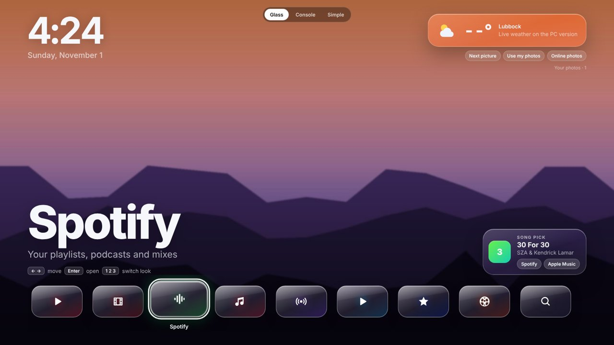
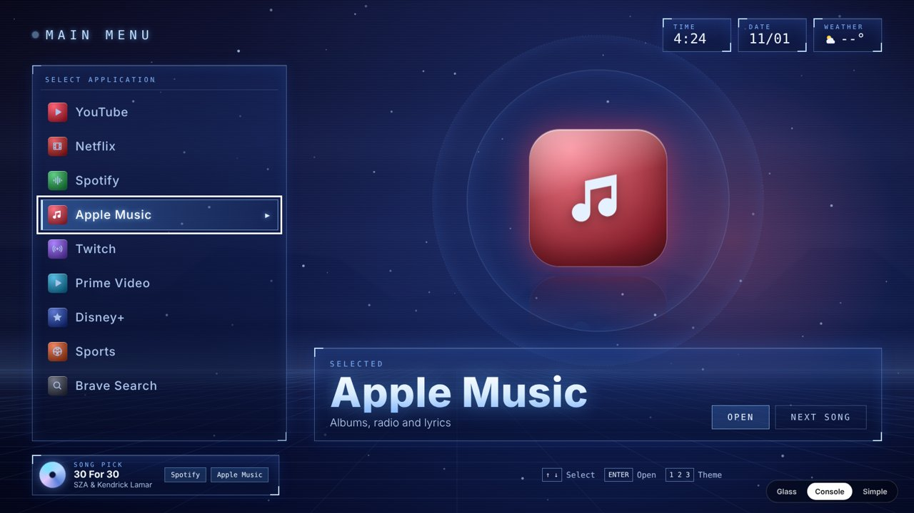
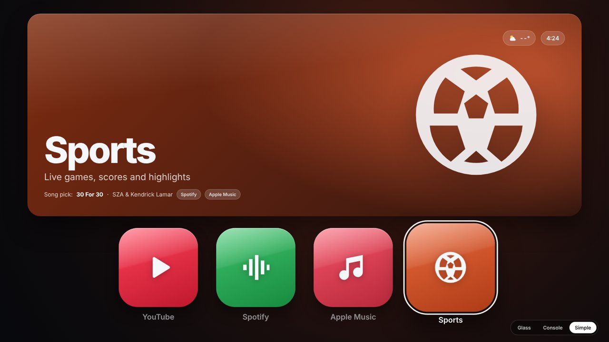
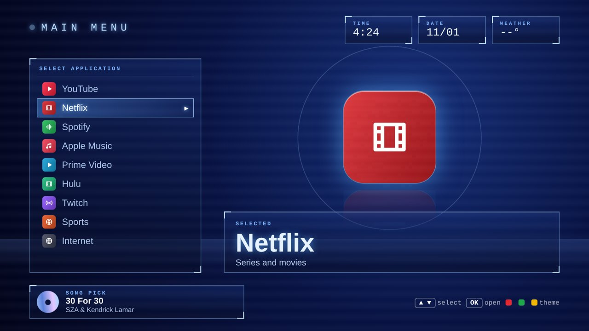

# TV Launcher

A cleaner, calmer home screen for an older Samsung smart TV, plus the privacy cleanup that went with it.

This project started as a weekend goal: take a 2015 Samsung 75" TV (UN75JU6500F), strip out as much tracking and clutter as the hardware allows, and give it a home screen that feels modern. It ended up as three things:

1. **A full-screen launcher for a PC connected to the TV**, with three looks and live weather.
2. **A version that installs directly on the TV** as a Tizen app, controlled with the normal Samsung remote.
3. **A short privacy checklist** for Samsung TVs of that era.

| Glass | Console | Simple |
| --- | --- | --- |
|  |  |  |

---

## What's in here

```
tv-launcher/
├── pc/                     Launcher for a PC plugged into the TV over HDMI
│   ├── TV-Launcher.html    The launcher (open it in any modern browser)
│   ├── Install-Brave.bat   Installs Brave, whose built-in Shields block ads
│   └── Open-TV-Launcher.bat Opens the launcher full-screen in Brave
├── tv-app/                 Version that installs on the TV itself
│   ├── TVLauncher/         The Tizen web app (config.xml, index.html, icon.png)
│   ├── Setup-Everything.bat Downloads the Tizen SDK, then installs the app
│   └── Install-TV-App.bat  Signs, packages and installs the app on the TV
└── docs/
    ├── PRIVACY-CLEANUP.md  Step-by-step tracking and ad cleanup for the TV
    ├── EXPLANATION.md      How everything works and why it was built this way
    └── screenshots/
```

## The three looks

- **Glass**: clear frosted-glass tiles over a photo background that changes every 10 minutes. Shows the time, live weather and a rotating song pick. You can swap in your own photos with **Use my photos**.
- **Console**: an early-2000s console-style menu with a vertical app list, framed HUD boxes for time, date and weather, a floating icon with rotating rings, scanlines and a faint grid floor.
- **Simple**: one large panel that takes on the selected app's color, with four big glossy icons underneath (YouTube, Spotify, Apple Music, Sports).

All three are original designs and use generic icons, not company logos.

## Option A: PC over HDMI (recommended)

This gives the full experience: glass blur, smooth animation, live weather and photos.

1. Connect a Windows PC to the TV with an HDMI cable (or use **Windows + K** to mirror wirelessly), and pick that input with **SOURCE** on the remote.
2. In `pc/`, double-click **Install-Brave.bat** once.
3. Double-click **Open-TV-Launcher.bat**.

**Controls:** arrow keys move, **Enter** opens, **1 / 2 / 3** (or **T**) switch looks.

## Option B: Install on the TV itself

A lighter version built for the TV's 2015 web engine. It opens the TV's own apps and dims the ones that aren't installed.



**Before you start**
- On the TV, open **Apps** and press **1 2 3 4 5** on the remote. Turn **Developer Mode** on, enter your PC's IP address, then restart the TV.
- Edit `set TV=` at the top of `tv-app/Install-TV-App.bat` to your TV's IP (**MENU → Network → Network Status**).

**Install**
1. Double-click **tv-app/Setup-Everything.bat**. It downloads Samsung's official Tizen SDK command-line tools (about 370 MB from download.tizen.org), installs them to `%USERPROFILE%\tizen-sdk`, then runs the app installer.
2. On later runs, use **Install-TV-App.bat** directly.
3. On the TV: **Smart Hub → Apps → My Apps → TV Launcher**.

**Remote controls:** arrows and **OK**, **red / green / yellow** switch looks, **RETURN** exits.

> Heads-up: some 2015 Samsung TVs remove sideloaded apps after a restart. If that happens, run `Install-TV-App.bat` again; it takes about 10 seconds.

## Customizing

Both versions keep their settings in a short block at the top of the script inside the HTML file:

| Setting | What it changes |
| --- | --- |
| `APPS` | Tile names, links (PC) or TV app search words (TV), colors, icons and descriptions |
| `SIMPLE` | Which four apps appear in the Simple look |
| `PLACE` | City name and coordinates for the weather |
| `SONGS` | The rotating song picks |
| `SHUFFLE_SECONDS` | How often the Glass background photo changes (default 600) |

## Privacy cleanup

The launcher sits on top of a TV that still has Samsung's software underneath. [docs/PRIVACY-CLEANUP.md](docs/PRIVACY-CLEANUP.md) covers the settings that actually matter: turning off viewing-data collection, ad-blocking DNS, and the honest limits of what a 2015 model allows.

## Troubleshooting

| What you see | What to try |
| --- | --- |
| Weather shows `--°` | Weather and online photos need internet access. On the TV they can also fail if its security certificates are outdated. |
| `Install-TV-App.bat` can't connect | Check Developer Mode is on with the right PC IP, the TV was restarted, and both devices are on the same network. |
| "Failed to install" | Read `install-log.txt` next to the script; it records every step. |
| App vanished from the TV | Run `Install-TV-App.bat` again. |

## How it works

For the full story, including why the TV can't simply run the PC version and why rooting was ruled out, see [docs/EXPLANATION.md](docs/EXPLANATION.md).

## Credits

- Weather from [Open-Meteo](https://open-meteo.com/) (free, no key needed)
- Background photos from [Lorem Picsum](https://picsum.photos/), which serves images from Unsplash
- Samsung's [Tizen SDK](https://developer.tizen.org/) for packaging and installing the TV app
- Fonts from Google Fonts (Figtree, Exo 2, Share Tech Mono)

App and service names (YouTube, Netflix, Spotify, Apple Music and others) belong to their owners. This project isn't affiliated with or endorsed by any of them, or by Samsung.
